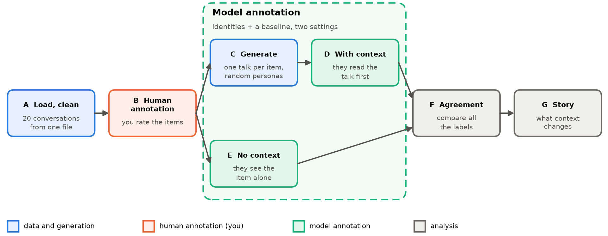
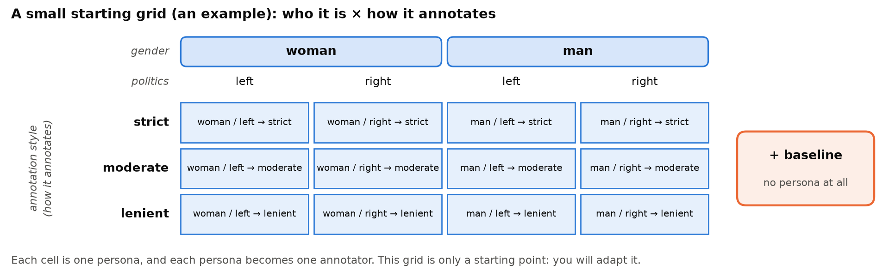
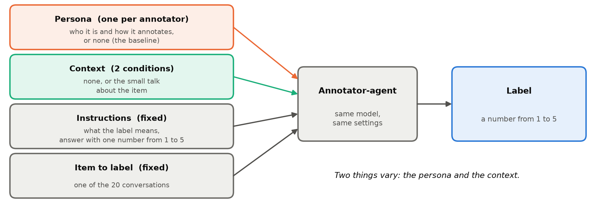

# Assignment 1: Do personas annotate like people, and does context change them?

| 📅 Deadline | 👤 Work | 🛠️ Tools |
|---|---|---|
| TBA | individual | Python, Colab (T4 GPU), SynDisco |

<!-- TODO(teacher): fill in the deadline; confirm the file format, the grading weights and the grid values -->

## 💡 <ins>The idea</ins>

In many data science problems the answer is not a fact. Is this comment toxic? Is this review sarcastic? Is this text offensive? Careful readers can disagree, and none of them is simply wrong. For these **subjective** tasks there is no ground truth to check a model against.

What we have is **annotation**: people read items and label them, following instructions. An annotation is not the truth. It is a **reference point**. It tells us what people say, how much they agree with each other (and that disagreement is information, not only noise), and where a model's judgments depart from theirs. That is how we find where a model can be trusted, and where it reaches its limit. To feel how this works, you will annotate the items yourself first.

Language models are now used as annotators too, often with a **persona** ("you are a 45-year-old conservative woman...") so that they label like a given group. And a model never reads a text in a vacuum: what it has just read can change its answer. So we look at the same 20 items in several ways: labelled by you, by persona annotators alone, and by the same annotators after reading a conversation about the item.

> 🎯 **When a model plays a person, do its labels look like those of real people? And what changes when it first reads a conversation about the text?**

| Part | You do | You hand in |
|---|---|---|
| **A** | Load the 20 conversations of the CSV we give you and clean them | the clean items |
| **B** | Rate the 20 items yourself, in the CSV | the CSV with your ratings and explanations |
| **C** | Generate one small conversation about each item | `generated.jsonl` |
| **D, E** | Persona annotators label the items, with the conversation as context (D) and alone (E) | the annotation files of both conditions |
| **F** | Measure agreement across everything | `agreement.json`, figures |
| **G** | Compare the two settings and tell the story | a short report |

> 📚 **Read first**
>
> - the SynDisco [overview](https://dimits-ts.github.io/syndisco/overview.html)
> - the [discussion guide](https://dimits-ts.github.io/syndisco/guides/creating_discussions.html)
> - the [annotation guide](https://dimits-ts.github.io/syndisco/guides/creating_annotations.html)
>
> Then answer for yourself: what is a persona, and what does the model receive? What do all the participants of a discussion share? What does an annotation experiment take as input, and what does it write?

> 💻 **Run it on Google Colab with a T4 GPU.** It is free, and the model runs much faster than on a CPU. In Colab: *Runtime → Change runtime type → T4 GPU*.

---

## 📥 <ins>A. Load and clean</ins>

We give you the 20 conversations in a **CSV file**: one row per item, with an id, the text, and two empty columns for your rating and your explanation. Load it in your code and make sure each conversation is one clean text. Fix only what needs fixing (empty or duplicate items, broken text), and show what you changed.

> ⚠️ **Content note:** the conversations may contain harsh language.

## ✍️ <ins>B. Human annotation: annotate by hand</ins>

Open the CSV in a spreadsheet (or any editor) and read each text. The file reads `text | rating (1-5) | explanation`: write your rating and **one sentence on why** beside every text. When you have finished, save the file and **load it into your code**. Match ratings to items by the item id: if you removed an item in part A, remove its rating too.

- **Label:** *How toxic is the item?* from **1 (fully civil) to 5 (very toxic)**. For the categorical view later, 1-2 are **civil** and 3-5 **toxic**.
- Rate alone, **before you look at any model's labels**, and do not change ratings afterwards.

## 💬 <ins>C. Generate one conversation per item</ins>

For each item, random participants with different identities have a short conversation about it, with the item as their starting context. One conversation per item, 20 in total, shown in your notebook. The how is explained in the SynDisco guide [Creating discussions](https://dimits-ts.github.io/syndisco/guides/creating_discussions.html).

> 💡 **Hints**
>
> - **Read the first conversations before generating all 20.** A small model may cut its answers off, refuse, repeat itself, or talk about the text instead of reacting to it. Check the output limit and your instructions.
> - One discussion per item. All participants must know the item: the guide shows how to give them a shared context.
> - The model gives the same output for the same input: the variety comes from your random participants (fixed seed).

## 🧩 <ins>Two uses of identities: the grid</ins>

Identities appear **twice** in this assignment, for **two different** jobs:

| | **C: conversations** | **D and E: annotation** |
|---|---|---|
| **Which identities** | a pool of random identities, only to make the conversations | the identities of the **grid**, chosen by you |
| **Who acts** | a few of the pool talk about each item, not all every time | **every** persona of the grid annotates **every** item, with context (D) or without (E) |

A **persona** is a short description of the annotator in its prompt: **who it is** (gender, politics, age...) and **how it annotates** (strict, moderate, lenient...). A **grid** lists a few values for each and combines them all. Each cell is one persona, and each persona is one annotator.

**The grid above will be given to you in the starting notebook.** For example, this is what the model could be told:

| Persona | What the model is told (example wording) |
|---|---|
| **woman / left → strict** | "You are a woman and you lean left. You are a strict annotator: you call a text toxic as soon as you see disrespect." |
| **man / right → moderate** | "You are a man and you lean right. You are a balanced annotator: you weigh the tone and the context." |
| **baseline** | nothing: no persona |

The baseline is what the model does by default.

> 🧩 **It is only a starting point: adapt it.** Add a dimension (age), a value ("non-binary"), a style (*literal*, *very strict*), or reword the personas. Keep it small, since every cell annotates all 20 items in two conditions. Write down the exact words each persona gets.

## 🤖 <ins>D and E. Annotate with and without context</ins>

There are two conditions. In **each** of them, every identity of your grid annotates every item, and so does the **baseline**, an annotator with no identity at all. It lets you tell whether a persona changes anything. So for each item and condition you get one label per persona, plus one from the baseline.

- **D, with context:** the annotator first reads the conversation generated for that item (part C), then labels **the item** (not the conversation).
- **E, no context:** the annotator sees only the item.

Only the persona (none, for the baseline) and the context change. Instructions, model, settings and items are identical.

> 💡 **Hints**
>
> - Ask for a number only (so the output limit must be short, unlike in part C), and expect the model not to always obey. Parse the answers, **count and show the invalid ones** per persona and condition, and do not fix them silently.
> - In D, the conversation has to reach the annotator somehow. Choose where it goes, and keep everything else the same as in E, so that only the context differs.
> - Test on 2 annotators and 3 items first, and open one output file: the persona and the prompt are saved in it.

## 📊 <ins>F. Agreement</ins>

> 🧮 **Why not percentage agreement?** If two annotators each call 18 of 20 items civil and agree on 17, that sounds good, but chance alone gives 0.9 × 0.9 + 0.1 × 0.1 = 82%. Cohen's kappa removes it: (0.85 − 0.82) / (1 − 0.82) ≈ **0.17**.

Compute and present everything in **two ways**: **categorical** (civil against toxic, Cohen's kappa) and **numerical** (1-5, weighted kappa or Spearman). Compare:

1. **you against each identity and the baseline**, no context;
2. **you against each identity and the baseline**, with context;
3. **each identity and the baseline, without against with context**: how much does the context move it? Is the baseline moved more or less than the identities?
4. **persona against persona**, within each condition (the baseline is one more annotator): a heatmap and one overall score (for example Krippendorff's alpha). Which dimension separates the personas the most?

> 🎯 **The key result: which identity annotates most like you?** Rank the personas by agreement with you, with and without context, and name the closest one **with all its attributes** (for example "closest to the *man / over 50 / left / high school*, strict"). Is it closer to you than the baseline is? Does it change when the context is added?

> 💡 **Hints**
>
> - Libraries: scikit-learn has [`cohen_kappa_score`](https://scikit-learn.org/stable/modules/generated/sklearn.metrics.cohen_kappa_score.html) (see its `weights`), statsmodels has [`fleiss_kappa`](https://www.statsmodels.org/stable/generated/statsmodels.stats.inter_rater.fleiss_kappa.html), and [`krippendorff`](https://pypi.org/project/krippendorff/) has Krippendorff's alpha (check which level of measurement fits a 1-5 label).
> - Match the items by id, and check for an annotator that always gives the same label: it breaks kappa.
> - Sanity check: a strict persona should rate higher than a lenient one. With 20 items, differences are noisy: say so.

## 📝 <ins>G. The report</ins>

Write a short report (2-3 pages). It has three parts.

**1. Justify your choices.** At each step say what you did **and why**: how you cleaned the items, how you rated, how you made the conversations, your grid (dimensions, values, exact wording of each persona), where you put the context, how you handled invalid answers.

**2. Tell the story.** Does context move the labels, and in which direction? Which identity is closest to you, and is it the same with and without context? Does the context bring the models closer to you or further away? Do the personas agree more or less with each other once they have read the conversation? Which identities move the most? Does a strict persona rate higher than a lenient one?

> ⚖️ **State clearly that the closest identity does not mean you *are* that identity.** Think about the limitations: 20 items, a small model, one generated conversation per item (and that conversation is itself a bias), no sampling, personas that are only descriptions.

**3. State how you used AI** (chatbots, code assistants...): for what, and what you checked yourself.

---

## ✅ <ins>Hand in and grading</ins>

**You upload:**

- [ ] **the notebook**, which runs top to bottom, with the seed written down and **every result displayed** in it (see below)
- [ ] **the CSV** with your 20 ratings and explanations, made before you saw any model output
- [ ] **the outputs**: the clean items, the 20 generated conversations, the annotation files of both conditions (every persona of your grid and the baseline, on all 20 items), and the agreement results with the figures
- [ ] **the report**

**Every result must be visible in the notebook.** Choose the clearest form (printed output, tables, figures), with titles and labels. A result that is computed but not shown does not count: someone reading your notebook must see each result without running anything.

Anything missing means it is not graded until complete.

<!-- TODO(teacher): confirm these weights -->

| Part | Weight |
|---|---|
| A | 10% |
| B | 15% |
| C | 20% |
| D, E | 20% |
| F | 20% |
| G | 15% |

> ❗ **Mandatory: every choice and every result in the report must be justified.**
>
> For each step, state **what** you did, **why** you did it, and **the result** you obtained. A choice without a reason, or a result without an explanation, will not be accepted. For example: "I used Cohen's kappa for the categorical comparison because [reason]; the values obtained are [values]."

🔗 **Links:** [SynDisco](https://dimits-ts.github.io/syndisco/) · [paper](https://arxiv.org/abs/2503.16505)
