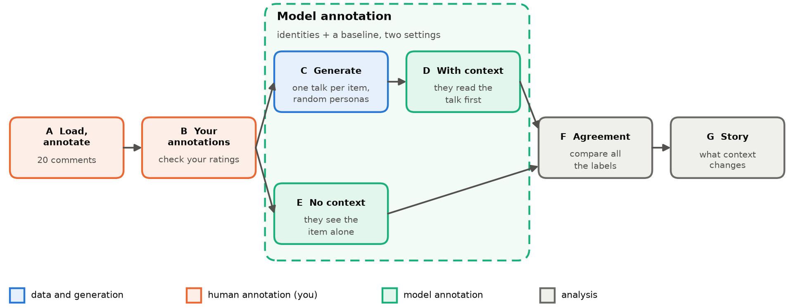
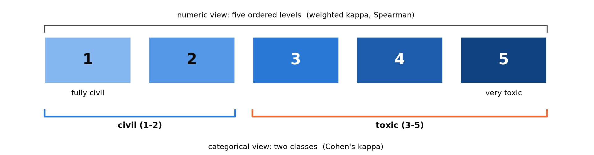
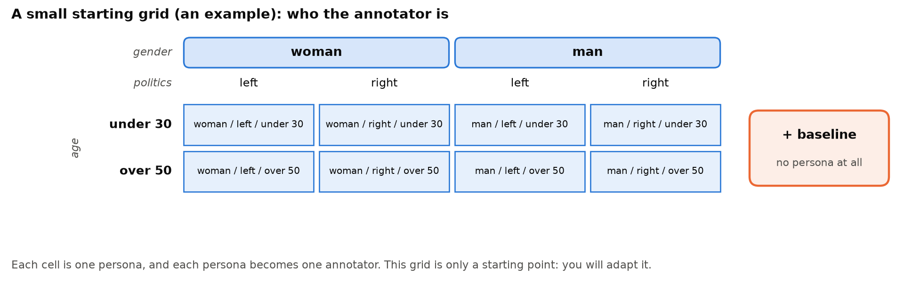
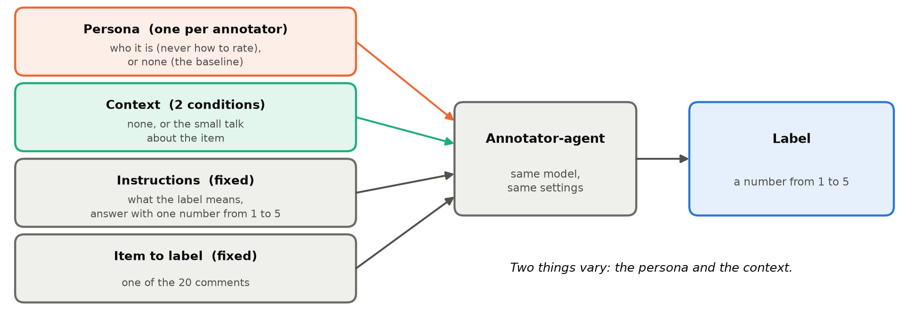

# Assignment 1: Do personas annotate like people, and does context change them?

| 📅 Deadline | 👤 Work | 🛠️ Tools |
|---|---|---|
| TBA | individual | Python, Colab (T4 GPU), SynDisco |

<!-- TODO(teacher): fill in the deadline (left as TBA for now) -->

## 💡 <ins>The idea</ins>

In many data science problems the answer is not a fact. Is this comment toxic? Is this review sarcastic? Is this text offensive? Careful readers can disagree, and none of them is simply wrong. For these **subjective** tasks there is no ground truth to check a model against.

What we have is **annotation**: people read items and label them, following instructions. An annotation is not the truth. It is a **reference point**. It tells us what people say, how much they agree with each other (and that disagreement is information, not only noise), and where a model's judgments depart from theirs. That is how we find where a model can be trusted, and where it reaches its limit. To feel how this works, you will annotate the items yourself first.

Language models are now used as annotators too, often with a **persona** ("you are a 45-year-old conservative woman...") so that they label like a given group. And a model never reads a text in a vacuum: what it has just read can change its answer. So we look at the same 20 items in several ways: labelled by you, by persona annotators alone, and by the same annotators after reading a conversation about the item.

> 🎯 **When a model plays a person, do its labels look like those of real people? And what changes when it first reads a conversation about the text?**

<p align="center"></p>

| Part | You do | You hand in |
|---|---|---|
| **A** | Draw **your own** 20 comments with the script, then annotate them yourself in the small web page we give you | your seed, `items_rated.csv` (ratings and evidence) |
| **B** | Load your annotations in your notebook and check them | the checked annotations, shown in the notebook |
| **C** | Generate one small conversation about each item | `generated.jsonl` |
| **D, E** | Persona annotators label the items, with the conversation as context (D) and alone (E) | the annotation files of both conditions |
| **F** | Measure agreement across everything | `agreement.json`, figures |
| **G** | Compare the two settings and tell the story | a short report |

> 📚 **Read first**
>
> - the SynDisco [overview](https://dimits-ts.github.io/syndisco/overview.html)
> - the [discussion guide](https://dimits-ts.github.io/syndisco/guides/creating_discussions.html)
> - the [annotation guide](https://dimits-ts.github.io/syndisco/guides/creating_annotations.html)
>
> Then answer for yourself: what is a persona, and what does the model receive? What do all the participants of a discussion share? What does an annotation experiment take as input, and what does it write?

> 💻 **Part A runs on your own computer** (Python 3 and a browser). **From part B on, use Google Colab with a T4 GPU**: it is free, and the model runs much faster than on a CPU (*Runtime → Change runtime type → T4 GPU*).

---

## 📥 <ins>A. Load and annotate</ins>

Two steps, in this order: **load** your own sample of comments with a script, then **annotate** it in a small web page. Do both **before you look at any model's labels**, and do not change your ratings afterwards.

### Step 1. Load: draw your own sample

> ⚠️ **Content note:** the comments may contain harsh language, insults, slurs and violent wording. That is what you are asked to rate.

You get a folder with the script `prepare_items.py` and `data/pool.csv`: 250 short comments from news-site discussions, from fully civil to very toxic. Each student rates a **different, personal sample of 20** of them. From that folder, run the script once, with your own seed (for example your student id):

```
pip install pandas
python prepare_items.py --seed 123456
```

(`pip install pandas` is needed only the first time.) It writes `items/items.csv` (your 20 items) and `items/annotate.html` (the page of step 2).

- **Seed:** the same seed gives the same 20 items, another seed gives another sample. Write it down for your notebook and report, and run the script **before** you start rating: a new run replaces the files, and your ratings would no longer match.
- **Range:** your sample mixes civil and toxic texts, so rate each one on its own.
- You do not need to open `data/pool.csv`: the script reads it for you.

### Step 2. Annotate: rate the 20 items in the page

<p align="center"></p>

**The label:** *How toxic is the item?* from **1 (fully civil) to 5 (very toxic)**. For the categorical view later, 1-2 are **civil** and 3-5 **toxic**. Use the whole scale if the text deserves it.

Open **`items/annotate.html`** in your browser (double-click it; it works offline). It opens on a **guidelines page** with the scale and what to look at: read it, then click *Start annotating* (the *Guidelines* button brings it back). The page shows one item at a time. For each item:

1. click a **rating from 1 to 5**; the label (`civil` for 1-2, `toxic` for 3-5) appears under the scale;
2. **select with the mouse the words that made you give this rating**: they are saved as your **evidence** and highlighted (select several parts if needed, remove one with the ×). For a civil text, select the words that show it is respectful.

*Next* stays locked until the item has a rating and at least one highlighted passage. Your answers are saved in the browser as you go, so you can close the page and come back (same browser, same seed; do not clear the site data before you download). When **all 20 items are complete**, the button **Download annotated CSV** appears and gives you `items_rated.csv`, with the columns `id | text | rating | label | evidence` (`label` is filled in from your rating).

## ✍️ <ins>B. Your annotations in the notebook</ins>

Upload `items/items.csv` and `items_rated.csv` to Colab, load them, and **check before you use them**. Show in the notebook:

- 20 rows, one per item id, the same texts as in `items.csv`, no missing rating or evidence, every rating a whole number from 1 to 5, and `label` consistent with `rating`. If you removed an item, remove its rating too;
- **how you rated**: a table or bar chart of your ratings (how many 1s ... 5s, how many civil and toxic), and two or three items with your evidence, to show how you used the scale.

`items_rated.csv` is your reference point for part F: keep it as it is.

## 💬 <ins>C. Generate one conversation per item</ins>

For each item (a comment), random participants with different identities have a short conversation about it, with the item as their starting context. One conversation per item, 20 in total, shown in your notebook. **You choose the settings**: how many participants talk, how many comments the conversation has, and how long each comment may be. The how is explained in the SynDisco guide [Creating discussions](https://dimits-ts.github.io/syndisco/guides/creating_discussions.html).

> 💡 **Hints**
>
> - **Read the first conversations before generating all 20.** A small model may cut its answers off, refuse, repeat itself, or talk about the text instead of reacting to it. **Experiment** on a few items and keep what works: the output limit, the instructions (ask for a first-person reaction), a repetition penalty, or a **larger model** from *Which model?*. Choose a **moderate size**: too short gives the annotators little to read, too long is slow (every comment is a model call) and may drift away from the item. Say in the report what you tried and what you chose.
> - One discussion per item. All participants must know the item: the guide shows how to give them a shared context.
> - Here you **may** guide the participants (their stance, how heated they are...) to get a varied, useful conversation: it is only context. This is the opposite of D and E, where a persona says only who it is.
> - The model gives the same output for the same input: the variety comes from your random participants (fixed seed).

## 🧩 <ins>Two uses of identities: the grid</ins>

Identities appear **twice** in this assignment, for **two different** jobs:

| | **C: conversations** | **D and E: annotation** |
|---|---|---|
| **Which identities** | a pool of random identities, only to make the conversations (here you **may** guide how they talk) | the identities of the **grid**, chosen by you |
| **Who acts** | a few of the pool talk about each item, not all every time | **every** persona of the grid annotates **every** item, with context (D) or without (E) |

A **persona** is a short description in the annotator's prompt of **who it is** (gender, politics, age...). It says **nothing about how to rate**: the instructions about the label are the same for every annotator. A **grid** lists a few values for each dimension and combines them all. Each cell is one persona, and each persona is one annotator.

<p align="center"></p>

The grid above is only an example to start from. This is what the model could be told for two of its cells:

| Persona | What the model is told (example wording) |
|---|---|
| **woman / left / under 30** | "You are a woman under 30 and you lean left." |
| **man / right / over 50** | "You are a man over 50 and you lean right." |
| **baseline** | nothing: no persona (what the model does by default) |

> 🧩 **It is only a starting point: adapt it.** Add a dimension (education, religion, origin...), add a value ("non-binary", "center"), or reword the personas. Keep it small, since every cell annotates all 20 items in two conditions. Write down the exact words each persona gets.
>
> ⚠️ **Describe who the annotator is, never how to rate.** No "strict", "lenient" or "rate harshly": how to rate comes only from the shared instructions (part D and E). Only the identity and the context may change the labels.

## 🧠 <ins>Which model?</ins>

A good small starting point is **Qwen2.5-3B-Instruct** (4-bit): fast, but weak, it may refuse, ramble or ignore the format. **You choose the model** (this one or one from the list) and run your notebook with it. **Trying models yourself is mandatory**: test at least two on a few items before you choose, and say in the report what you tried and why you chose this one. You may also run a second model on the whole task to see whether your results hold. All of these are pre-shrunk to 4 bits, need no account or token, and fit the 16 GB of a Colab T4:

| Model (`model_path`) | Size | Download | Licence | Why try it |
|---|---|---|---|---|
| [`unsloth/Qwen2.5-3B-Instruct-bnb-4bit`](https://huggingface.co/unsloth/Qwen2.5-3B-Instruct-bnb-4bit) (**starting point**) | 3B | 2.1 GB | Apache 2.0 | The default: small and fast, but the weakest |
| [`unsloth/Qwen2.5-7B-Instruct-bnb-4bit`](https://huggingface.co/unsloth/Qwen2.5-7B-Instruct-bnb-4bit) | 7B | 5.5 GB | Apache 2.0 | Same family, larger: what does size change? |
| [`unsloth/Llama-3.1-8B-Instruct-bnb-4bit`](https://huggingface.co/unsloth/Llama-3.1-8B-Instruct-bnb-4bit) | 8B | 5.7 GB | Llama 3.1 community | A strong general model from another family |
| [`unsloth/Phi-4-mini-instruct-bnb-4bit`](https://huggingface.co/unsloth/Phi-4-mini-instruct-bnb-4bit) | 4B | 2.9 GB | MIT | A different kind of small model, good with instructions |

To use another one, change only `model_path` where you create the model:

```python
model = TransformersModel(
    model_path="unsloth/Llama-3.1-8B-Instruct-bnb-4bit",  # the start was "unsloth/Qwen2.5-3B-Instruct-bnb-4bit"
    name="base_model",
    max_out_tokens=120,  # long enough for a comment; a label needs far less
)
```

A larger model usually follows the instructions better but is slower (8B takes about twice as long per call as 3B, and you make hundreds of calls).

> ⚠️ **Rules**
>
> - **One model per run**, the same in D and E, for every persona and the baseline. To compare models, repeat the whole of D and E for each and say so in the report.
> - **We have not tested these models with SynDisco: that is your job.** If a model fails (a system-prompt error, answers that are never a number), try another and say what happened.
> - **No reasoning models** (the *Qwen3* family): their long chain of thought breaks the "number only" output.
> - Load **one model at a time**: free the GPU (`del model`, restart the runtime if needed) before the next.

## 🤖 <ins>D and E. Annotate with and without context</ins>

There are two conditions. In **each** of them, every identity of your grid annotates every item, and so does the **baseline**, an annotator with no identity at all. It lets you tell whether a persona changes anything. So for each item and condition you get one label per persona, plus one from the baseline.

- **D, with context:** the annotator first reads the conversation generated for that item (part C), then labels **the item** (not the conversation).
- **E, no context:** the annotator sees only the item.

<p align="center"></p>

Only the persona (none, for the baseline) and the context change. Instructions, model, settings and items are identical.

> 💡 **Hints**
>
> - Ask for a number only (so the output limit must be short, unlike in part C), and expect the model not to always obey. Parse the answers, **count and show the invalid ones** per persona and condition, and do not fix them silently.
> - In D, the conversation has to reach the annotator somehow. Choose where it goes, and keep everything else the same as in E, so that only the context differs.
> - Test on 2 annotators and 3 items first, and open one output file: the persona and the prompt are saved in it.

## 📊 <ins>F. Agreement</ins>

> 🧮 **Why not percentage agreement?** A small model often calls almost everything civil. If you and a model each call 18 of 20 items civil and agree on 17, that sounds good, but chance alone gives 0.9 × 0.9 + 0.1 × 0.1 = 82%. Cohen's kappa removes it: (0.85 − 0.82) / (1 − 0.82) ≈ **0.17**.

Compute and present everything in **two ways**: **categorical** (civil against toxic, Cohen's kappa) and **numerical** (1-5, weighted kappa or Spearman). Compare:

1. **you against each identity and the baseline**, no context;
2. **you against each identity and the baseline**, with context;
3. **each identity and the baseline, without against with context**: how much does the context move it? Is the baseline moved more or less than the identities?
4. **persona against persona**, within each condition (the baseline is one more annotator): a heatmap and one overall score (for example Krippendorff's alpha). Which dimension separates the personas the most?

> 🎯 **The key result: which identity annotates most like you?** Rank the personas by agreement with you, with and without context, and name the closest one **with all its attributes** (for example "closest to the *woman / left / over 50*"; if you added dimensions, name all of them). Is it closer to you than the baseline is? Does it change when the context is added?

> 💡 **Hints**
>
> - Libraries: scikit-learn has [`cohen_kappa_score`](https://scikit-learn.org/stable/modules/generated/sklearn.metrics.cohen_kappa_score.html) (see its `weights`), statsmodels has [`fleiss_kappa`](https://www.statsmodels.org/stable/generated/statsmodels.stats.inter_rater.fleiss_kappa.html), and [`krippendorff`](https://pypi.org/project/krippendorff/) has Krippendorff's alpha (check which level of measurement fits a 1-5 label).
> - Match the items by id, and check for an annotator that always gives the same label: it breaks kappa.
> - Personas that only say who they are may differ little from each other and from the baseline, and with 20 items one changed label can move a kappa a lot: say so, and do not over-read small differences.
> - **Optional:** you may measure that uncertainty (for example a bootstrap confidence interval over the items, or a kappa of shuffled labels as a chance level). If you do, explain what it shows and how it changes your conclusions.

## 📝 <ins>G. The report</ins>

Write a short report (2-3 pages). It has three parts.

**1. Justify your choices.** At each step say what you did **and why**: your seed, how you checked the items, how you rated (the guidelines you followed, an example of your evidence), how you made the conversations (the number of participants and of comments, the length limit, and why you chose them after experimenting), the model you chose (which ones you tried, and why this one), your grid (dimensions, values, exact wording of each persona), where you put the context, how you handled invalid answers.

**2. Tell the story.** Does context move the labels, and in which direction? Which identity is closest to you, and is it the same with and without context? Does the context bring the models closer to you or further away? Do the personas agree more or less with each other once they have read the conversation? Which identities move the most? Do the personas differ from the baseline at all, and which dimension (gender, politics, age...) matters most?

> ⚖️ **State clearly that the closest identity does not mean you *are* that identity.** Think about the limitations: 20 items, a small model, one generated conversation per item (and that conversation is itself a bias), no sampling, personas that are only descriptions.

**3. State how you used AI** (chatbots, code assistants...): for what, and what you checked yourself.

---

## ✅ <ins>Hand in and grading</ins>

**You upload:**

- [ ] **your notebook**, which runs top to bottom, with the seed written down and **every result displayed** in it (see below)
- [ ] **your seed** and **`items_rated.csv`**, downloaded from the annotation page (20 ratings, labels, evidence), made before you saw any model output
- [ ] **the output files** of each part:
  - `items.csv`: your 20 comments (part A);
  - `generated.jsonl`: the 20 generated conversations (part C);
  - the **annotation files of the model annotators**, for both conditions, with and without context (parts D and E): one file per annotator, that is every persona of your grid plus the baseline, each with all 20 items;
  - `agreement.json` and the **figures** (part F).
- [ ] **the report**

**Every result must be visible in the notebook.** Choose the clearest form (printed output, tables, figures), with titles and labels. A result that is computed but not shown does not count: someone reading your notebook must see each result without running anything.

Anything missing means it is not graded until complete.

| Part | Weight |
|---|---|
| A | 15% |
| B | 10% |
| C | 20% |
| D, E | 20% |
| F | 20% |
| G | 15% |

> ❗ **Mandatory: every choice and every result in the report must be justified.**
>
> For each step, state **what** you did, **why** you did it, and **the result** you obtained. A choice without a reason, or a result without an explanation, will not be accepted. For example: "I used Cohen's kappa for the categorical comparison because [reason]; the values obtained are [values]."

🔗 **Links:** [SynDisco](https://dimits-ts.github.io/syndisco/) · [paper](https://arxiv.org/abs/2503.16505)
